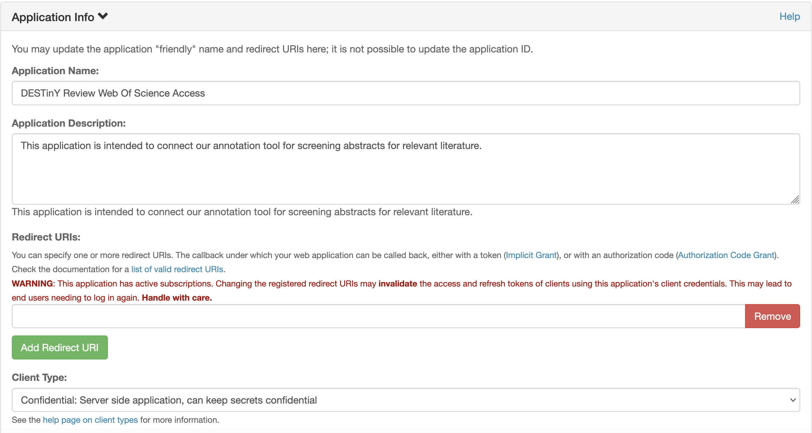

# API Key Generation Guide

This guide aims to offer an overview of the process of requesting API keys for the providers supported by this package. The aim is to provide a clear and repeatable set of steps for users wishing to use the tool in 'local' mode, which requires bringing your own keys.

The guide covers the following currently supported providers:

- Elsevier (Scopus, ScienceDirect) - referred to as 'Scopus' in the code.
- Web of Science

As the number of supported providers expands, this guide will be updated.

In all cases, it is left to the user to ensure that API keys are stored securely, not committed to version control, not shared with others, and not used in any way that violates the terms of service of the provider. The package does not store or manage API keys, and it is the user's responsibility to ensure that they are used appropriately.

## Scopus/ScienceDirect API Key Generation

API key generation for Scopus/ScienceDirect is fairly straightforward. It's important to note that the API key is tied to your Elsevier account, and you will need to use your institutional email address to leverage any existing subscriptions your institution may have with Elsevier. Additionally, if you require use of the key outside of your institution's network, you will need to request an Instiution Token from Elsevier, which is a separate and manual process described below.

### API Key Generation

Visit the [Elsevier Developer Portal](https://dev.elsevier.com/) and select `I want an API key` from the menu. You will be prompted to log in or create an account if you don't already have one. Use your institutional email address for this step, in order to leverage the existing subscription your institution may have with Elsevier. After logging in, you'll be shown any existing keys you have.

Create a new key by selecting `Create API Key`. Add an appropriate label and website URL for your application. The website URL is not required, but the label is useful in order to identify keys and manage them. You will also need to read and agree to the API Service Agreement, as well as the additional TDM provisions if you plan to use the key for text and data mining over full texts from ScienceDirect. Once you have agreed to the terms, click `Create Key`. You will then be shown your new API key, which you should copy and store securely.

### Institution Token Generation

To generate an institution token (inst token), email [datasupportRD@elsevier.com](mailto:datasupportRD@elsevier.com) from your registered institutional email address requesting an insitution token matched to an existing API key. You'll likely receive a reply requesting further information, and you should be prepared to provide at least the API key you generated earlier, which is used to link the inst token. The inst token requires your to also use the specific API key in any request, and will not work with other API keys you may have generated.

## Web of Science API Key Generation

Visit the [Clarivate Developer Portal](https://developer.clarivate.com/apis/wos) and log in or register with your institutional email if you haven't done so previously. Select `APIs` at the top and select [Web of Science Expanded](https://developer.clarivate.com/apis/wos). You'll need to register an application the bottom of the page in order to register API keys against. A suggested set of sample values for the application is provided below:

Once the application is registered, scroll to the bottom of the [Web of Science Expanded](https://developer.clarivate.com/apis/wos)page and select the green `Subscribe` button to request the API key. Note: This can take a while and is a manual process. This largely hinges on the existing agreements your institution has with Clarivate, and you may need to follow up with your library or research office to ensure the request is processed. Once the request is approved, you will receive an email with your API key, which you should copy and store securely.
